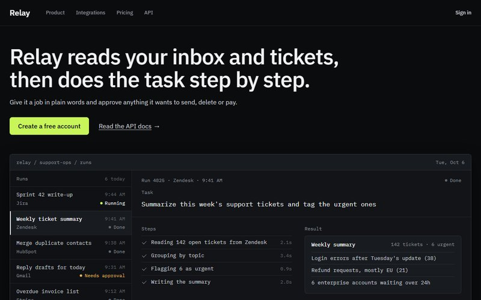
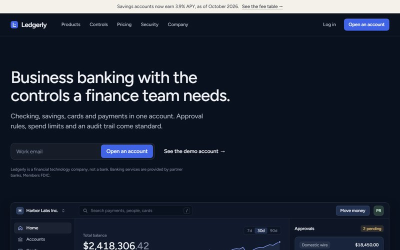
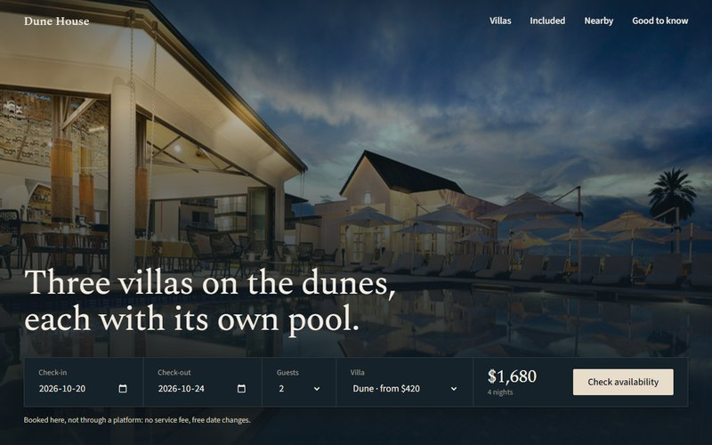
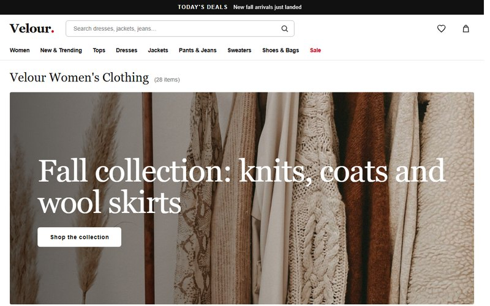
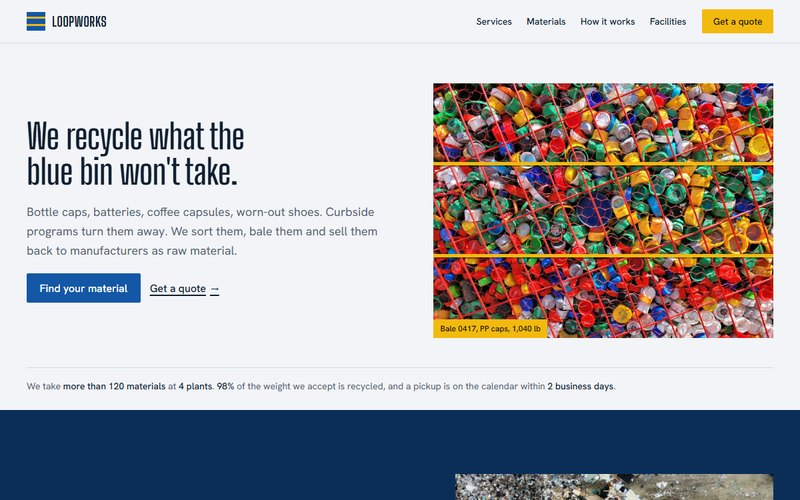
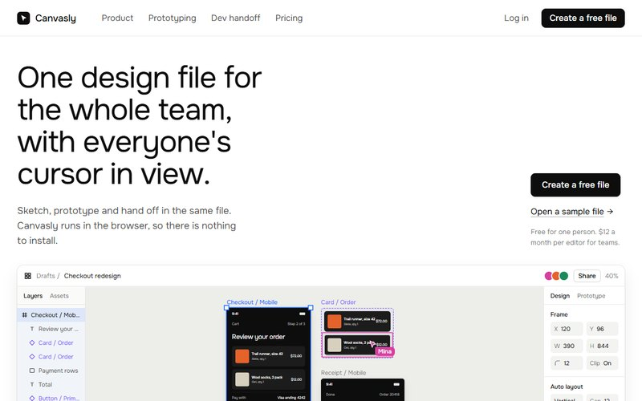
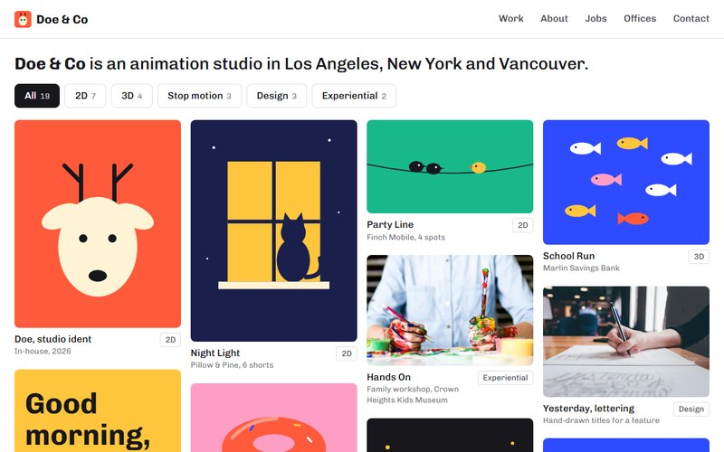
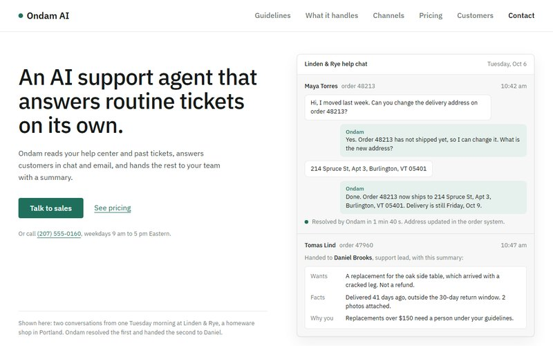
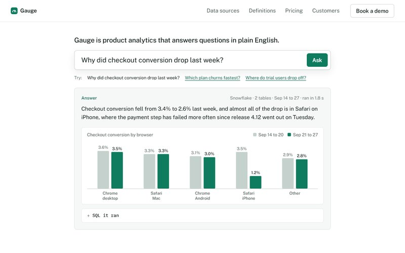

# siteboard — design showcase

**Live site: [siteboardhq.com](https://siteboardhq.com)**

siteboard sells ready-made small-business websites (101 templates: cafés, clinics, fashion, SaaS, hotels, portfolios and more). A buyer should only need to swap the photos and the words — the layout, colour, type and sections already speak the industry's language.

This repo is a **showcase for design feedback**. It holds screenshots, three full demo templates, and the design rules behind every template. The shop itself (payments, all 101 templates) lives in a private repo.

## What I'd love feedback on

Open an [issue](../../issues/new/choose) or comment on anything. Especially useful:

1. **First impression of the board** at [siteboardhq.com](https://siteboardhq.com) — is it clear within 5 seconds what this is and what it costs?
2. **Template quality** — pick any demo below. Would a small-business owner trust this as their site? What feels generic or "template-y"?
3. **Checkout flow** — from a template page to the Stripe checkout. Where do you hesitate?
4. **Mobile** — any layout that breaks or feels cramped on a phone.
5. **Industry fit** — read [DESIGN-DIRECTIONS.md](DESIGN-DIRECTIONS.md). Does a template actually follow its industry's rules?

Blunt feedback is welcome. "This looks like every other template" is useful if you tell me why.

## Demos in this repo

Open the HTML files directly in a browser, no build step.

| Template | Industry | Demo | Live |
|---|---|---|---|
| Relay | AI agent startup | [demos/ai-agent.html](demos/ai-agent.html) | [page](https://siteboardhq.com/templates/ai-agent-startup-website-template) |
| Ledgerly | Fintech & banking | [demos/fintech.html](demos/fintech.html) | [page](https://siteboardhq.com/templates/fintech-banking-website-template) |
| Dune House | Pool villa stay | [demos/villa.html](demos/villa.html) | [page](https://siteboardhq.com/templates/pool-villa-stay-website-template) |

## Screenshots

| | | |
|---|---|---|
|  |  |  |
|  |  |  |
|  |  |  |

## Design a template, earn a share

I'm a solo builder. If you design a template that gets added to the shop, you get a designer credit on its product page and **2% of that template's sales**. Details in [CONTRIBUTING.md](CONTRIBUTING.md).

## Stack

Plain HTML/CSS, no framework. Hosted on Vercel; checkout via Stripe.

## License

Code and design files in this repo: [MIT](LICENSE). Screenshots and demo photos are for review purposes only.
